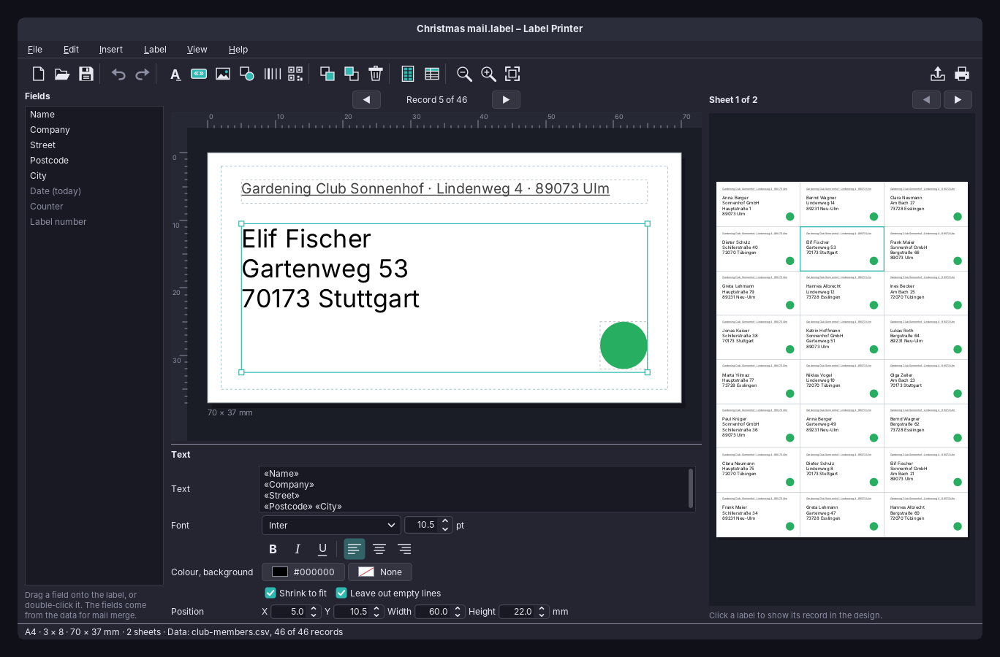
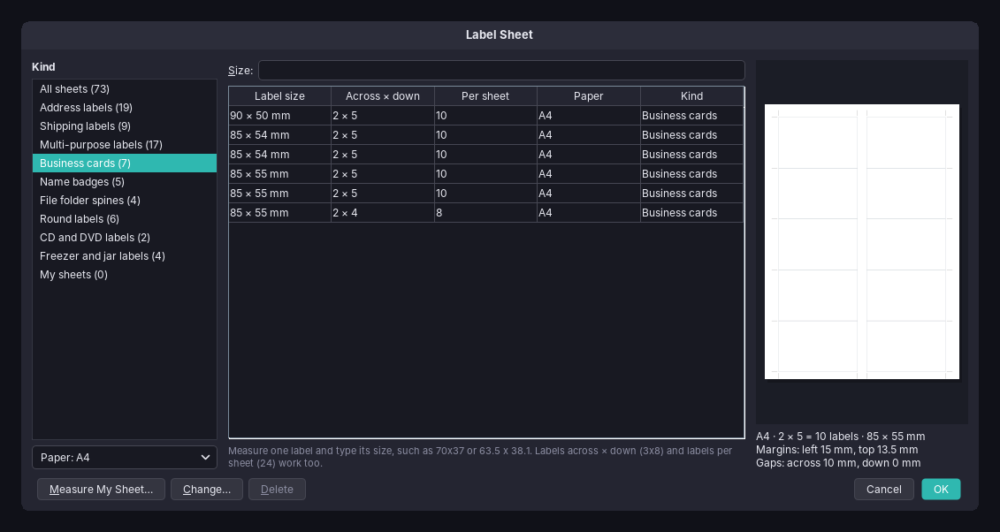
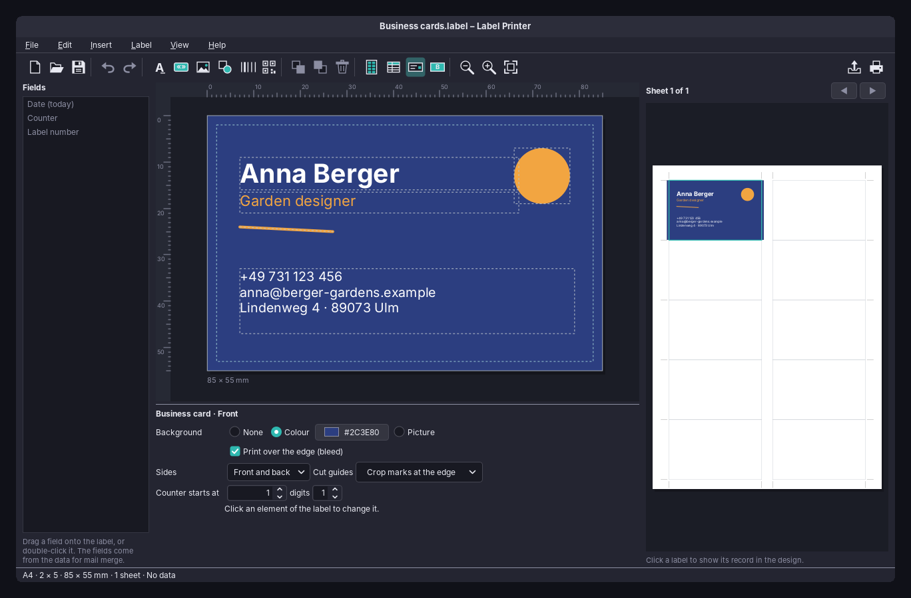

# amade-labelprinter

**amade-labelprinter** (Label Printer) is the label and business card program of the [amadeOS](https://github.com/amadeos-eu/amadeos) desktop. It designs one label (an address, a shipping label, a name badge, a business card, a jar label) and prints it on sheets of many labels, such as A4 with 3 × 8 address labels. With mail merge, each label gets the next record of a list: a spreadsheet, a CSV file, the contacts of the Contacts app, or lines typed in. Built like the other amadeOS applications.




## Features

- **Label sheets**: a catalogue of about 70 common sheet sizes (address, shipping and multi-purpose labels, business cards, name badges, file folder spines, round labels, CD and DVD labels, freezer and jar labels) on A4, A5, A6 and Letter, listed by size and layout. Typing the size printed on the package (`70x37`, `63.5 x 38.1`, `3x8`, `24`) finds the sheet. A sheet that is not in the list is measured once in the sheet editor: paper, labels across and down, label size, margins, gaps, rectangle with corners, ellipse or disc with a hole. The drawing follows every change, and a sheet whose labels do not fit on the paper cannot be saved.

  
- **Design**: text, fields, pictures, shapes (rectangle, ellipse, line), barcodes (EAN-13, EAN-8, Code 128, Code 39) and QR and Data Matrix codes, placed in millimetres with a ruler. Elements are moved with the mouse or the arrow keys, sized with handles, put in front or behind, duplicated and deleted; every change can be undone.
- **Text and colours**: font, size, bold, italic, underline, alignment, text colour and a background colour per text; *Shrink to fit* makes a long name smaller instead of cutting it; *Leave out empty lines* closes the gap when a record has no company. The label or card gets a background colour or picture, optionally printed to the edge (bleed).
- **Business cards**: front and back, each with its own design. Cut guides are either an outline round each card or crop marks at the edge of the sheet, outside the cards, so nothing is printed on the cards themselves.

  
- **Mail merge**: fields such as `«Name»` in a text or code are filled from the data. The data comes from
  - a file: CSV or tab-separated text (the separator and encoding are recognised), OpenDocument or Excel spreadsheet (`.ods`, `.xlsx`), or vCard (`.vcf`);
  - the Contacts app, all contacts or one group;
  - addresses typed in the dialog, separated by an empty line.

  Records can be unticked, filtered (`City = Ulm`, `City != Ulm`, or any text), sorted and printed several times each. A field whose column has another name is matched to it by hand. Built-in fields: *Date (today)*, *Counter* (with a start number and leading zeros, for numbered tickets) and *Label number*.
- **Preview**: the whole sheet, as printed, beside the design; clicking a label shows its record in the design.
- **Print** on any printer, or **save as PDF**. A sheet that is partly used is printed from the first free label, picked on the drawing. Print all records, only the current one, or the current label on the whole sheet (a full sheet of the same business card). A shift in millimetres corrects a printer that prints a little off, and a test page shows the outlines to check against a sheet held to the light.
- **Files**: a design is saved as a `.label` file, a ZIP with `label.json` (the sheet, the design, the data source and the mail merge settings) and the pictures, so it can be moved to another computer.
- Five languages (English, Deutsch, Français, Español, Italiano), following the amadeOS desktop language; *Options → Language* overrides it. The first sheet follows the paper size of the region (A4 or Letter).
- Icon toolbar, theme colours, Motif and Horizon look from [amade-commons](https://github.com/amadeos-eu/amade-commons).

### Keys

| Key | Action |
|---|---|
| Ctrl+N, Ctrl+O, Ctrl+S | New, open, save (Ctrl+Shift+S: save as) |
| Ctrl+E | Save as PDF |
| Ctrl+P | Print |
| Ctrl+Z, Ctrl+Y | Undo, redo |
| Ctrl+D | Duplicate |
| Delete, Backspace | Delete the selected element |
| Arrow keys | Move the selected element by 0.5 mm (Shift: 5 mm) |
| Tab, Shift+Tab | Select the next, previous element |
| Ctrl+Shift+Up/Down | Bring to front, send to back |
| Ctrl+Shift+T, F, I | Insert a text, a field, a picture |
| Ctrl+L | Label sheet |
| Ctrl+M | Data for mail merge |
| F5 | Read the data again |
| Ctrl+Page Up/Down | Previous, next record |
| Ctrl+Plus, Ctrl+Minus, Ctrl+0 | Zoom |
| F1 | Handbook |

## Platforms

Linux (deb), the amadeOS desktop. The program is plain Java and Swing and also runs elsewhere from the jar. Printing goes to the CUPS printers; *Save as PDF* uses Ghostscript (`ps2pdf`).

## Architecture

Java 25, Swing and Guice; start-up, theme and language come from `AmadeApplication` in amade-commons. Barcodes and QR codes are drawn with ZXing.

| Package | Contents |
|---|---|
| `bootstrap` | `AmadeLabelPrinterApplication` (a `.label` file as argument is opened), `LabelPrinterModule`, `Windows` |
| `domain` | `SheetTemplate` (paper, grid, label size, margins, gaps, shape), `SheetKind`, `LabelDesign` (sheet, front, back, cut guides), `Side`, `Element` (text, picture, figure, code), `TextStyle`, `Background`, `CutGuides`, `DataSource`, `DataTable`, `MergeSettings`, `Merge` (filter, sort, copies, fields), `Placeholders`, `PrintPlan` (labels on sheets from a start position) |
| `repository` | `LabelPreferences` (`~/.config/amadeos/labelprinter/labelprinter.properties`: last sheet, last folder, printer, shift) |
| `service` | `SheetCatalog` (built-in sheets and own sheets in `own-sheets.json`), `SheetCodec`, `LabelFiles` (`.label`), `DataLoader`, `CsvReader`, `SpreadsheetReader`, `ContactColumn`, `LabelPainter`, `SheetPainter`, `SheetPages` (pages for printing), `PdfExport` (PostScript to PDF), `DesktopOpener` |
| `ui.main` | main window, presenter, `MainView` |
| `ui.parts` | `DesignCanvas` (ruler, handles, keys, dropping fields), `PropertiesPanel`, `SheetView`, `ColorButton`, `LabelGlyph` (toolbar icons) |
| `ui.dialogs` | sheet chooser, sheet editor, data, print |

Everything is measured in millimetres; the same painter draws the design, the preview, the PDF and the printed page, so what is seen is what is printed. The presenter knows the window only through the `MainView` interface, so the tests drive designing, mail merge, undo, PDF export and printing without Swing.

## Build and run

```sh
./gradlew run                                         # a new label on the sheet used last
./gradlew run --args="Documents/Christmas.label"      # open a design, as from Files
./gradlew test                                        # Swing tests need a display: xvfb-run ./gradlew test
./gradlew deb                                         # build/distributions/amade-labelprinter_<version>_all.deb
```

If `../amade-commons` is checked out next to this repository, Gradle builds against that checkout instead of the published version.

## Planned

- More sheets in the catalogue as people ask for them
- Images per record (a photo column for name badges)
- Templates to start from: return address, name badge, jar label, business card
